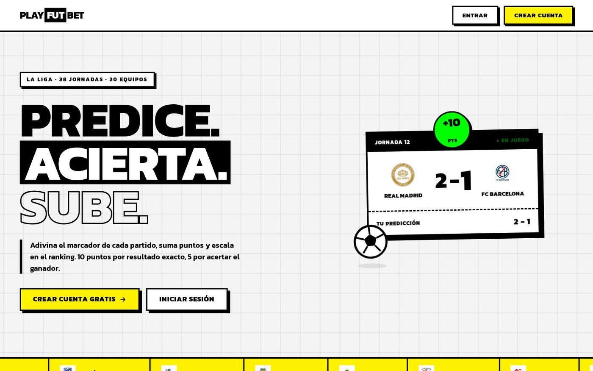
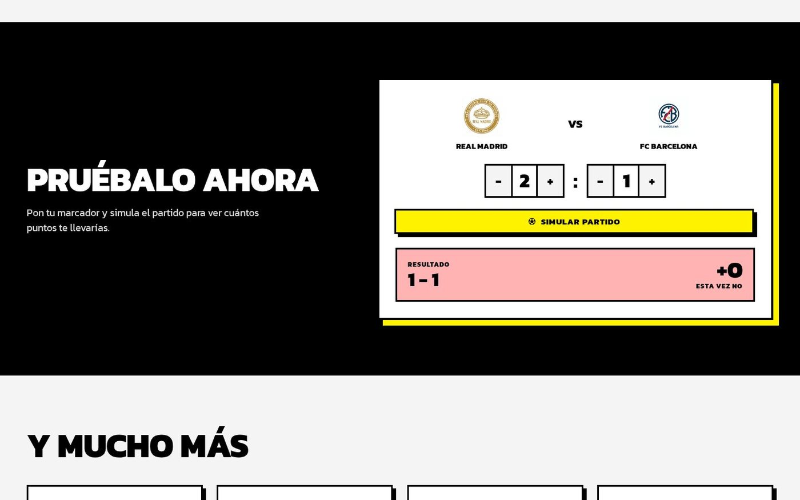
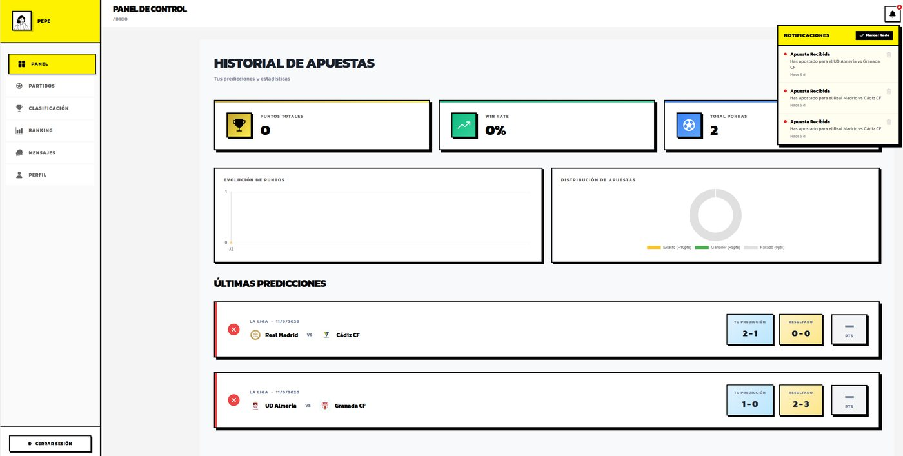
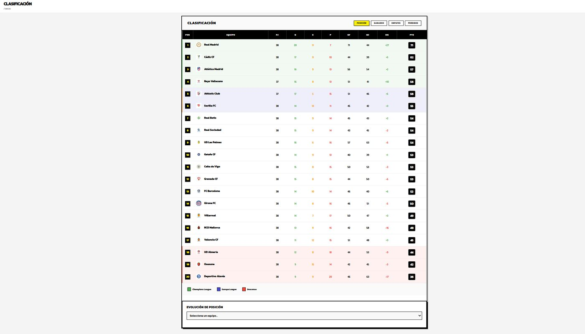
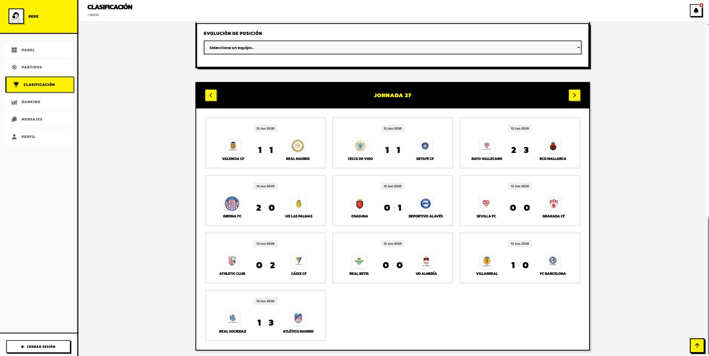
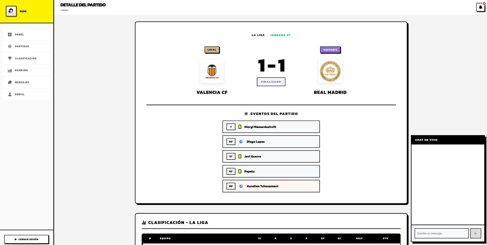
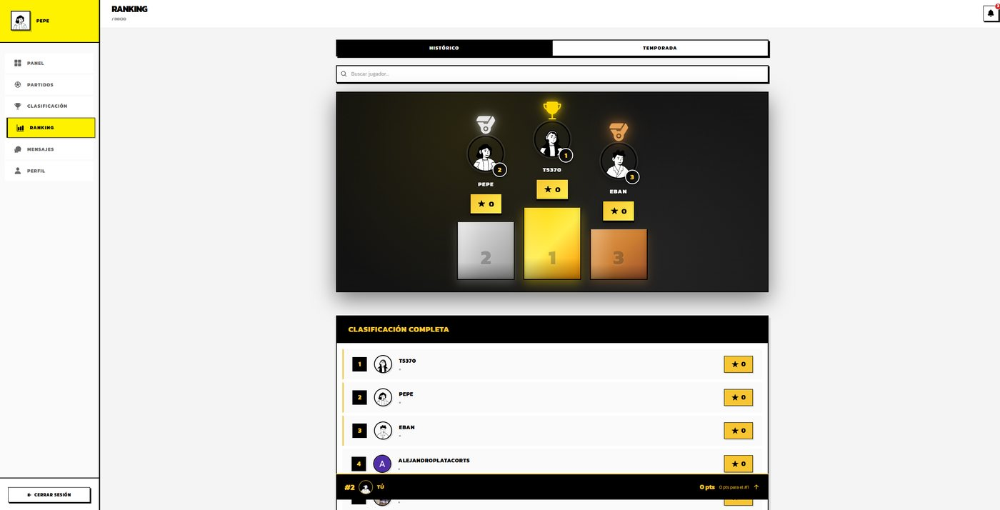

<h1 align="center">PlayFutBet</h1>

<p align="center">
  <b>Predice los resultados de La Liga y escala en el ranking.</b><br>
  Aplicación full-stack de predicciones de fútbol sobre una temporada simulada (38 jornadas, 20 equipos).
</p>

<p align="center">
  <a href="https://playfutbet.vercel.app/login"><b>Demo</b></a> ·
  <a href="https://playfutbet-back.onrender.com/api-docs"><b>Swagger UI</b></a> ·
  <a href="#capturas">Capturas</a> ·
  <a href="#arranque-local">Arranque local</a>
</p>

<p align="center">
  
  
  
  
  
  
  
  
  
  
  
</p>

<p align="center">
  
</p>

> El backend corre en el plan gratuito de Render y se duerme tras 15 minutos sin tráfico: la primera petición puede tardar hasta un minuto.

## Qué hace

| | |
|---|---|
| **Predicciones** | Adivina el marcador de cada partido: **10 puntos** por resultado exacto y **5** por acertar ganador o empate. Historial con seguimiento de aciertos |
| **Liga simulada** | Temporada de 380 partidos con progresión en directo, eventos minuto a minuto (goles y tarjetas según la fuerza de cada equipo) y avance automático de jornadas, con recuperación si el servidor se cae |
| **Clasificación y estadísticas** | Tabla con puntos, goles y victorias/empates/derrotas, goleadores, plantillas y estadísticas por equipo |
| **Social** | Ranking global y por temporada, perfiles con avatar, mensajería privada y chat en directo durante los partidos |
| **Notificaciones** | Apuesta ganada, hitos de temporada y ranking final |
| **Acceso** | Registro e inicio de sesión con usuario y contraseña o con Google, sesión con JWT |
| **Móvil** | La misma app como aplicación Android con Capacitor |

## Capturas

<table>
<tr><td align="center"><br><sub><b>Landing: prueba tu predicción</b></sub></td><td align="center"><br><sub><b>Panel con tus predicciones</b></sub></td></tr>
<tr><td align="center"><br><sub><b>Clasificación</b></sub></td><td align="center"><br><sub><b>Resultados por jornada</b></sub></td></tr>
<tr><td align="center"><br><sub><b>Detalle del partido con chat</b></sub></td><td align="center"><br><sub><b>Ranking de jugadores</b></sub></td></tr>
</table>

## Arquitectura

```
┌───────────────────┐   HTTP + JWT   ┌───────────────────┐   pg   ┌────────────┐
│  front            │ ─────────────► │  back             │ ─────► │ PostgreSQL │
│  Ionic + Angular  │ ◄───────────── │  Express + Swagger│        └────────────┘
│  (Vercel)         │      JSON      │  simulation.js    │ ─────► Supabase Storage
└───────────────────┘                │  (Render)         │        (avatares)
                                     └───────────────────┘
```

| Capa | Tecnologías |
|---|---|
| Cliente | Angular 20, Ionic 8, TypeScript, Capacitor 8 (Android), Chart.js, RxJS |
| API | Node.js, Express 5, PostgreSQL (`pg`), JWT, Zod, Helmet, CORS, rate limiting, Multer + Supabase Storage |
| Documentación | Swagger / OpenAPI en `/api-docs` |
| Despliegue | Vercel (front) · Render (back) |

## API

| Prefijo | Descripción |
|---|---|
| `/api/register`, `/api/login` | Autenticación (JWT) |
| `/api/matches` | Partidos de la jornada actual y detalle |
| `/api/bets` | Crear y consultar predicciones |
| `/api/league/standings` | Clasificación |
| `/api/league/results/:jornada` | Resultados por jornada |
| `/api/players/top-scorers` | Máximos goleadores |
| `/api/teams/:name/players` | Plantilla del equipo |
| `/api/leaderboard` | Ranking de usuarios |
| `/api/conversations` · `/api/messages/:matchId` | Mensajería privada y chat de partido |
| `/api/notifications` | Notificaciones del usuario |
| `/api/simulation/state` | Estado actual de la temporada |

La documentación completa está en [`/api-docs`](https://playfutbet-back.onrender.com/api-docs).

## Arranque local
Necesitas Node.js 20+, PostgreSQL y (opcional) el CLI de Ionic (`npm i -g @ionic/cli`).

```bash
# Backend (http://localhost:3000)
cd back
npm install
# crea back/.env con: DATABASE_URL, JWT_SECRET, FRONTEND_URL,
# GOOGLE_CLIENT_ID, SUPABASE_URL, SUPABASE_SERVICE_ROLE_KEY y SUPABASE_BUCKET
node index.js

# Frontend, en otra terminal
cd front
npm install
ionic serve        # o: npm start
```

## Estructura
```
PlayFutBet/
├── front/                 # Cliente Ionic + Angular
│   └── src/app/
│       ├── pages/         # landing-page, auth, dashboard (panel, partidos, clasificación, ranking, perfil, mensajes…)
│       ├── services/      # Clientes HTTP
│       ├── guards/        # Guards de autenticación
│       ├── components/    # Notificaciones, gráficas, detalle de equipo…
│       └── layouts/       # Layout del dashboard
├── back/                  # API Express
│   ├── index.js           # Servidor y configuración
│   ├── simulation.js      # Motor de simulación de la liga
│   ├── rutas/             # auth, users, matches, bets, messages, notifications
│   ├── servicios/         # Almacenamiento de avatares (Supabase)
│   ├── middleware/        # Autenticación
│   └── swagger-docs.js    # Documentación de la API
└── docs/screenshots/      # Capturas de pantalla
```

---
<p align="center">Proyecto personal de <a href="https://github.com/Alejandro-Plata">Alejandro Plata Cortés</a></p>
